# Module 01: Windows Server 2022 Lab Setup & Baseline Configuration

## Overview
This guide walks through creating a virtualized **Windows Server 2022** machine (`DC-01`) in VMware Workstation Pro 17 and configuring its foundational network and system settings. Completing this baseline properly ensures reliable DNS and Active Directory communication in later modules.

### Prerequisites
- **Host Machine:** Windows 10/11 PC with at least 8 GB RAM and 50 GB free SSD space
- **Hypervisor:** VMware Workstation Pro 17
- **Installation Media:** Windows Server 2022 Standard Evaluation ISO

---

## Step 1: Create and Allocate Resources to the Virtual Machine

### 1.1 Launch the New Virtual Machine Wizard
Open **VMware Workstation Pro 17** and click **Create a New Virtual Machine** on the home screen to begin provisioning the server.

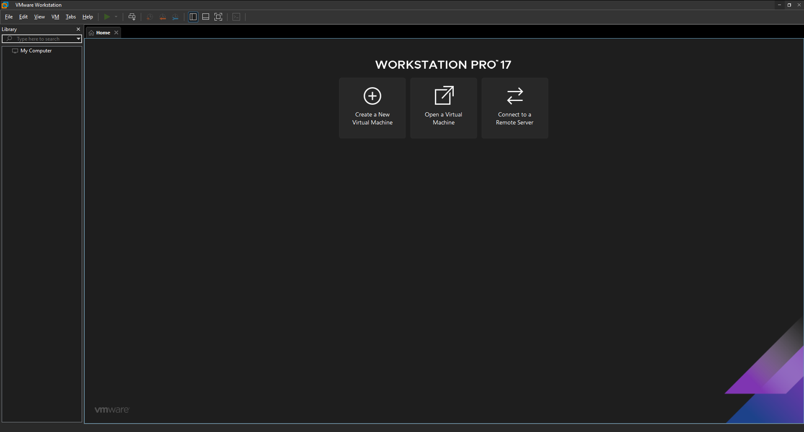

---

### 1.2 Choose Custom Configuration
Select **Custom (advanced)** and click **Next >**. Choosing *Custom* instead of *Typical* gives us full control over the storage controller type, firmware mode (UEFI), and virtual network adapter.

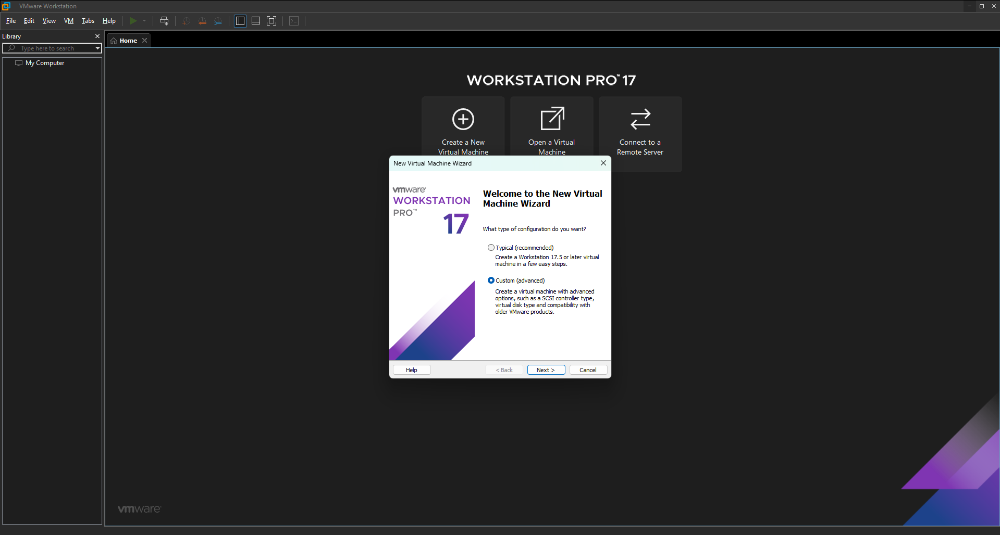

---

### 1.3 Select Virtual Machine Hardware Compatibility
Leave the default **Workstation 17.5 or later** selected and click **Next >**. This unlocks modern virtual hardware limits (such as UEFI boot and NVMe virtual disk support) required by modern Windows Server operating systems.

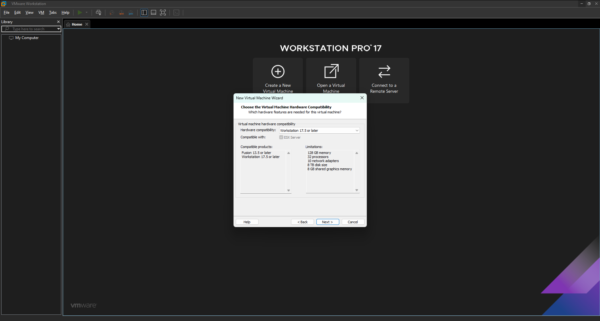

---

### 1.4 Bypass Automated Easy Install
Select **I will install the operating system later** and click **Next >**.
> **Why this matters:** If you select the `.iso` file on this screen, VMware triggers *Easy Install*, which automatically generates default partitions, creates a generic local user, and attaches a virtual floppy script (`autoinst.flp`). Bypassing it lets us configure Windows Server cleanly like a real bare-metal installation.

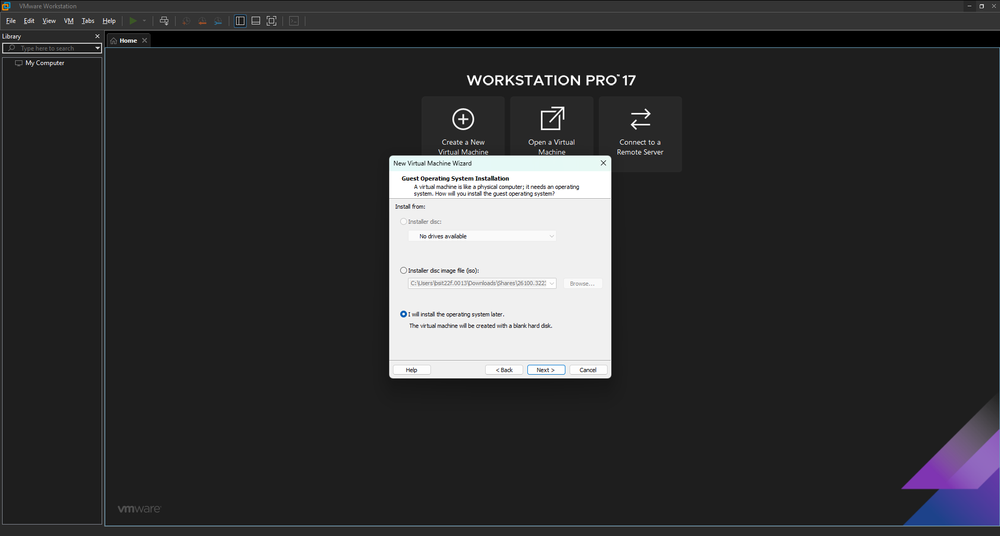

---

### 1.5 Select Guest Operating System
Choose **Microsoft Windows** and select **Windows Server 2025 / Windows Server 2022** from the version dropdown, then click **Next >**. This tells VMware which default virtual drivers and chipset profiles to prepare for the guest OS.

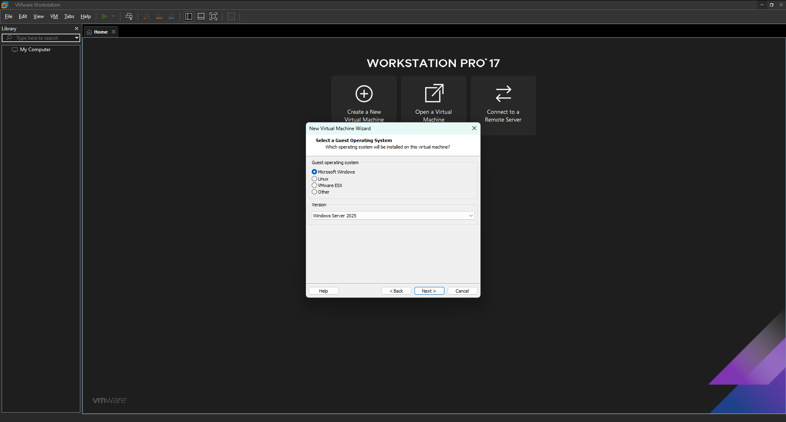

---

### 1.6 Name the Virtual Machine & Set Storage Location
Set the **Virtual machine name** to **`DC-01`** and set the **Location** to **`D:\VMs\DC-01`**, then click **Next >**.
> **Best Practice:** Always create a dedicated subfolder (`\DC-01`) for each VM. VMware does not automatically create a subfolder for the VM name, so putting all VMs in the root `D:\VMs` folder mixes `.vmdk` virtual disk files together.


---

### 1.7 Select Firmware Type (UEFI)
Select **UEFI** (leave *Secure Boot* unchecked to avoid driver signing conflicts in lab environments) and click **Next >**. Modern Windows Server installations use UEFI and GPT partition tables rather than legacy BIOS.

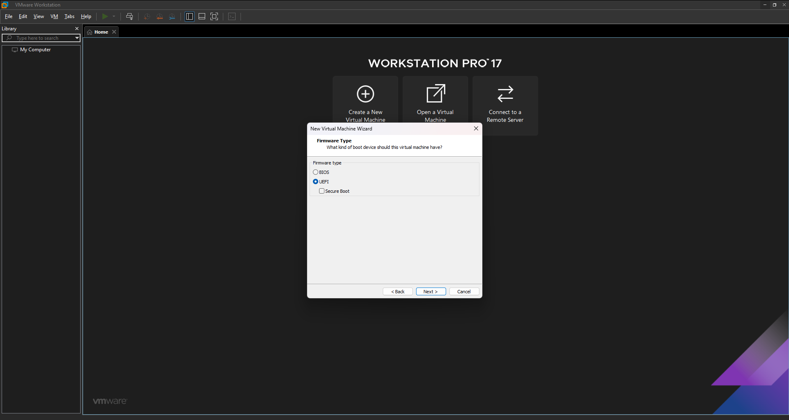

---

### 1.8 Configure Processor Allocation
Set **Number of processors** to **`1`** and **Number of cores per processor** to **`2`** (**Total processor cores: `2`**), then click **Next >**. Allocating 2 vCPUs prevents single-thread bottlenecks during Windows updates and Active Directory role installations.

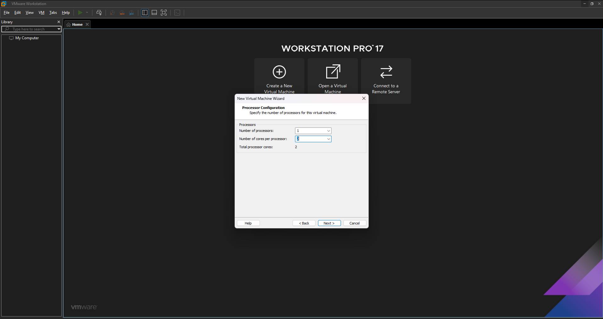

---

### 1.9 Configure Memory (RAM) Allocation
Allocate **`4096 MB` (4 GB)** of RAM for optimal server performance and click **Next >**.
> **Host Tuning Tip (8 GB RAM PCs):** If your physical host machine has only **8 GB of total RAM**, drop this allocation to **`2560 MB` (2.5 GB)** or **`3072 MB` (3 GB)** after installation so Windows 11 retains enough free memory and does not lag due to disk swapping.

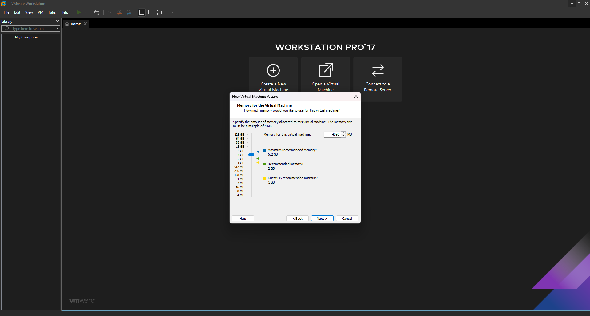

---

### 1.10 Select Network Connection Type (NAT)
Select **Use network address translation (NAT)** and click **Next >**.
> **Why NAT instead of Bridged?** NAT connects `DC-01` to VMware's isolated `VMnet8` virtual switch. Your server gets full internet access through the host's IP address, while preventing future lab DHCP scopes and Active Directory broadcasts from leaking onto your home or office physical network.

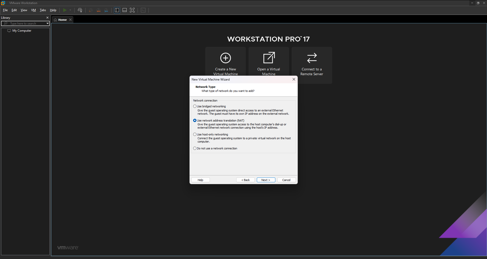

---

### 1.11 Select I/O Controller Type (LSI Logic SAS)
Keep **LSI Logic SAS (Recommended)** selected and click **Next >**. Windows Server includes native built-in storage drivers for LSI Logic SAS out of the box, ensuring the installer immediately detects the virtual hard drive without requiring third-party driver disks.

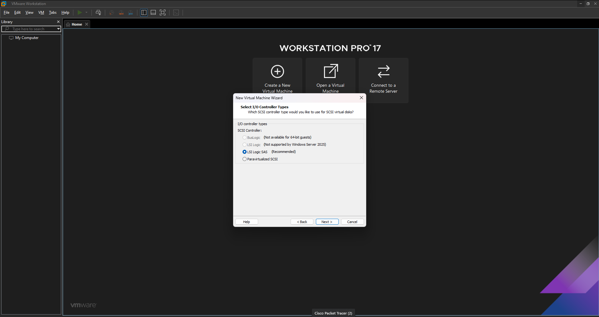

---

### 1.12 Select Virtual Disk Type (NVMe)
Leave **NVMe (Recommended)** selected and click **Next >**. Regardless of whether your physical host drive is an NVMe or SATA SSD, virtual NVMe provides lower CPU overhead and faster I/O queue handling inside Windows Server than legacy virtual SATA or IDE controllers.

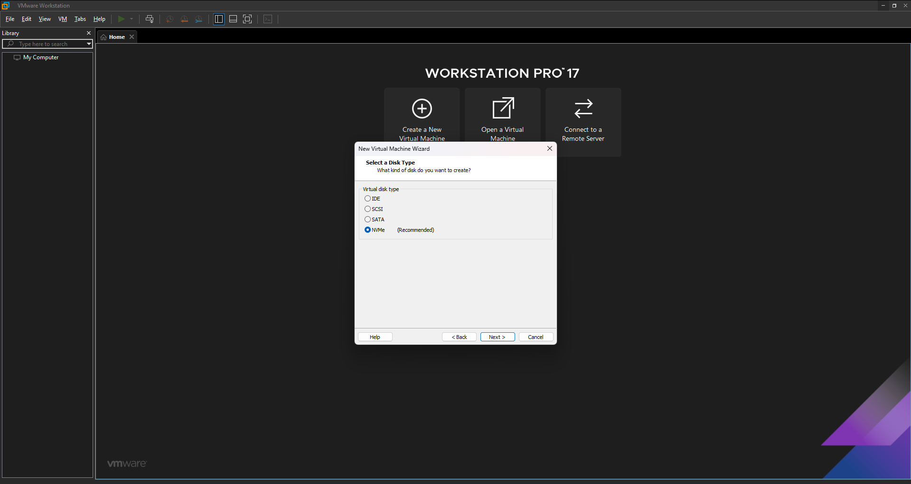

---

### 1.13 Select Disk Creation Mode
Select **Create a new virtual disk** and click **Next >**. This provisions a clean, isolated `.vmdk` virtual hard drive inside `D:\VMs\DC-01` rather than risking raw physical disk access or reusing an existing virtual drive.

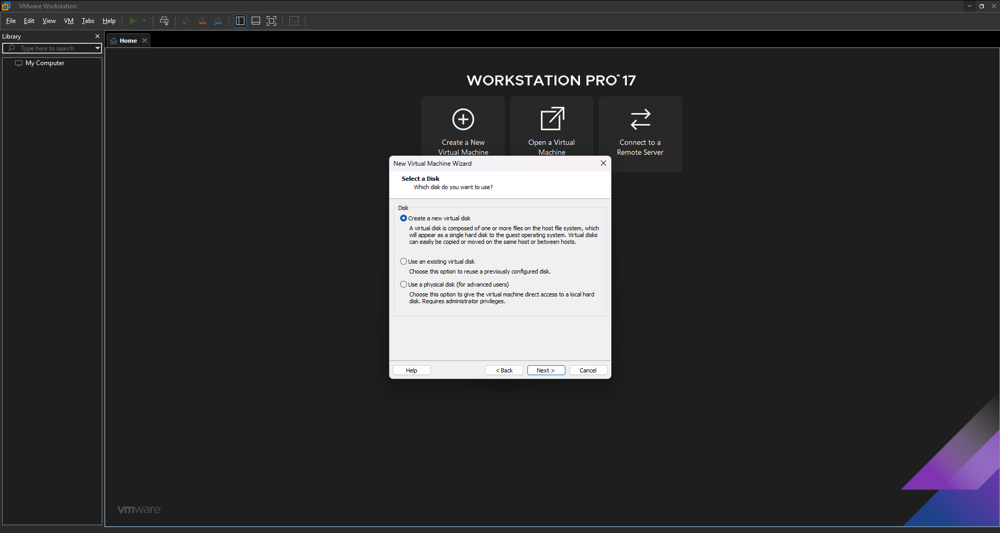

---

### 1.14 Specify Disk Capacity (`80 GB`)
Set **Maximum disk size (GB)** to **`80.0`**, leave **Allocate all disk space now** unchecked (thin provisioning), select **Store virtual disk as a single file**, and click **Next >**.
> **Storage Note:** Because *Allocate all disk space now* is unchecked, VMware only consumes ~15–20 GB on your physical `D:` drive initially and grows dynamically up to 80 GB as roles and logs are added.


---

### 1.15 Confirm Virtual Disk Filename
Accept the default disk filename **`DC-01.vmdk`** (automatically stored inside `D:\VMs\DC-01`) and click **Next >**.

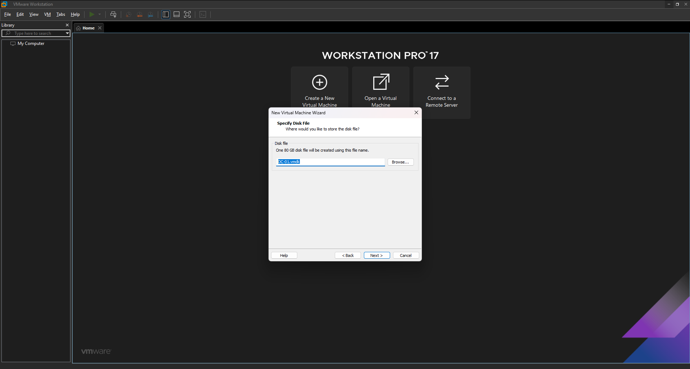

---

### 1.16 Review Summary & Attach Windows Server ISO
On the **Ready to Create Virtual Machine** summary screen, click **Customize Hardware...** before finishing so we can attach the installation media.

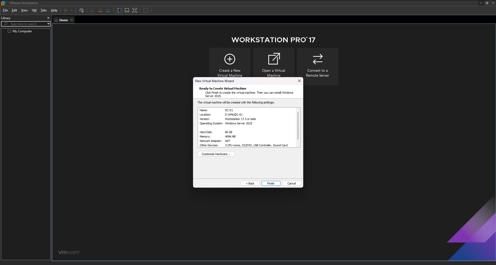

In the **Hardware** window, select **CD/DVD (SATA)**, choose **Use ISO image file**, browse to your Windows Server `.iso` (`D:\SERVER_EVAL_x64FRE_en-us.iso`), verify **Connect at power on** is checked, and click **Close** > **Finish**.

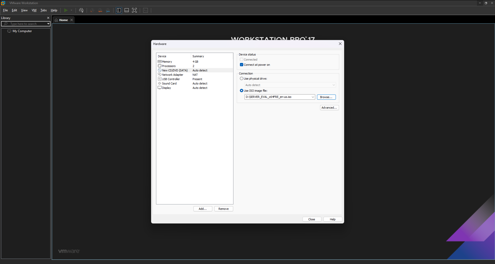

---

### 1.17 Power On the New Virtual Machine
Confirm **`DC-01`** appears in your VMware library with all allocated hardware (`4 GB` RAM, `2` Processors, `80 GB` NVMe disk, `NAT` network), then click **Power on this virtual machine** and press any key when prompted to boot from the virtual DVD drive.

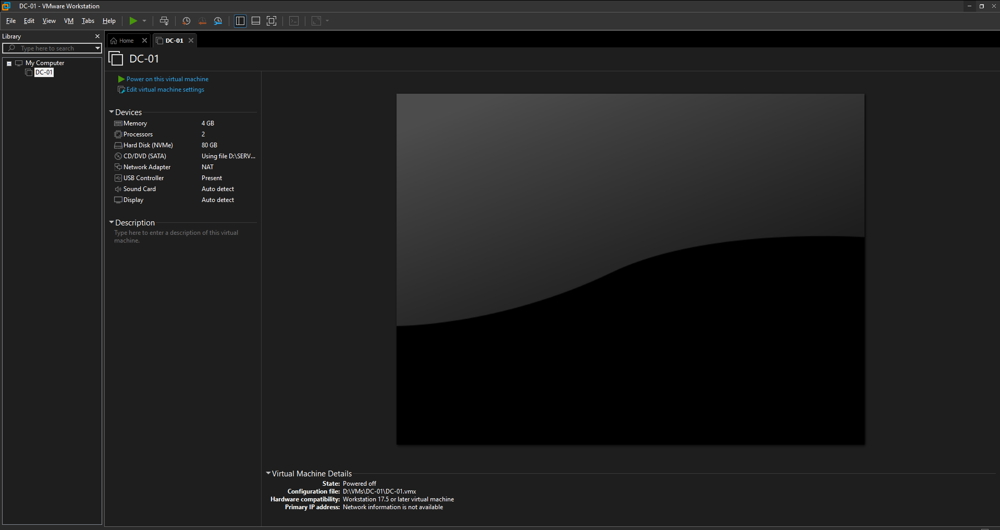

---

## Step 2: Install Windows Server (Desktop Experience)

### 2.1 Configure Regional Settings
Once the Windows Setup wizard boots from the ISO, verify **Language to install**, **Time and currency format**, and **Keyboard or input method** are set to **English (United States)** / **US** and click **Next**.

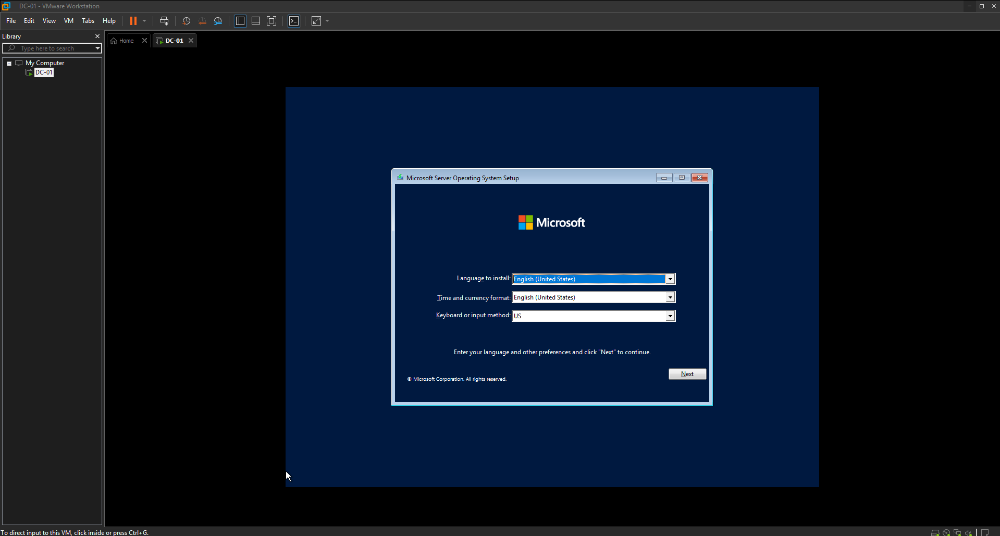

---

### 2.2 Start Installation
Click **Install now** to launch the Windows Server edition and disk partitioning wizard.

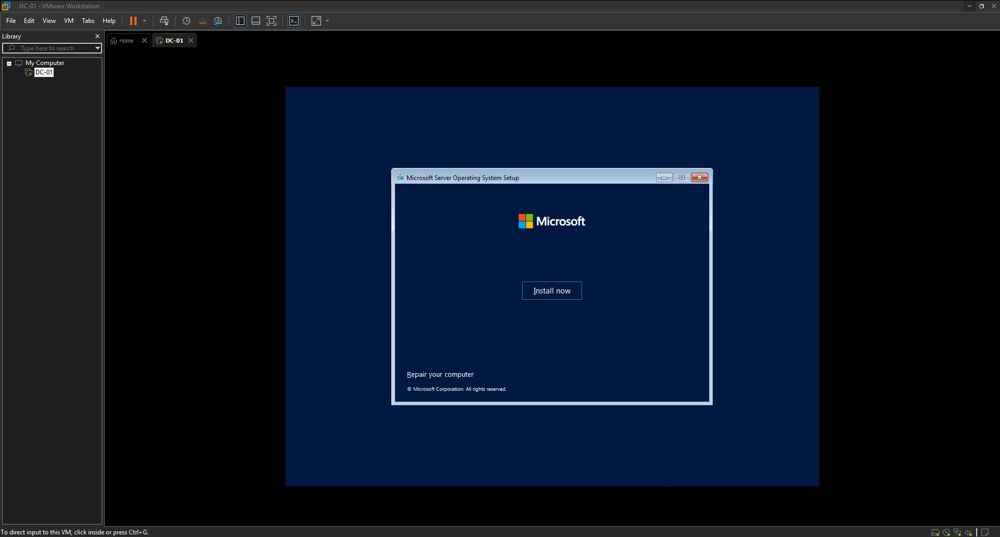

---

### 2.3 Select Operating System Edition (Desktop Experience)
Select **Windows Server 2022 Standard Evaluation (Desktop Experience)** and click **Next**.
> **Important:** Do **not** select the standard option without *(Desktop Experience)*. That installs **Server Core**, which runs purely via command line without a graphical desktop or Server Manager GUI.

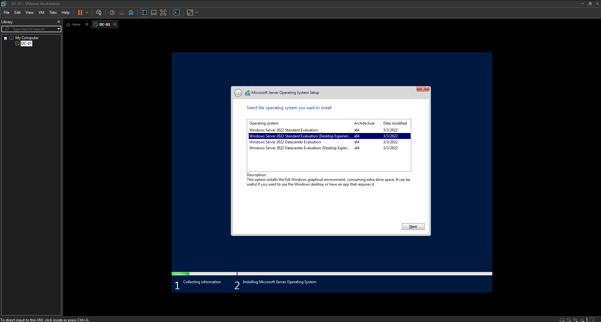

---

### 2.4 Accept Software License Terms
Check **I accept the Microsoft Software License Terms** and click **Next**.

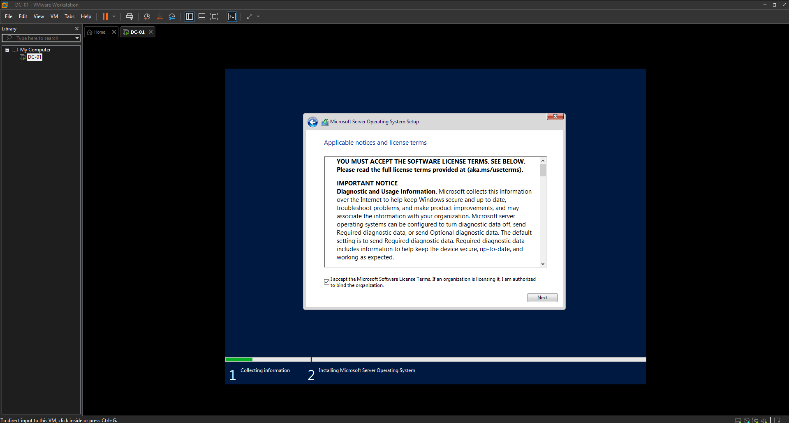

---

### 2.5 Select Target Virtual Drive
When prompted for installation type, choose **Custom: Install Microsoft Server Operating System only (advanced)**, select **`Drive 0 Unallocated Space` (80.0 GB)**, and click **Next**. Windows Setup automatically creates the required EFI, MSR, and primary NTFS recovery partitions.

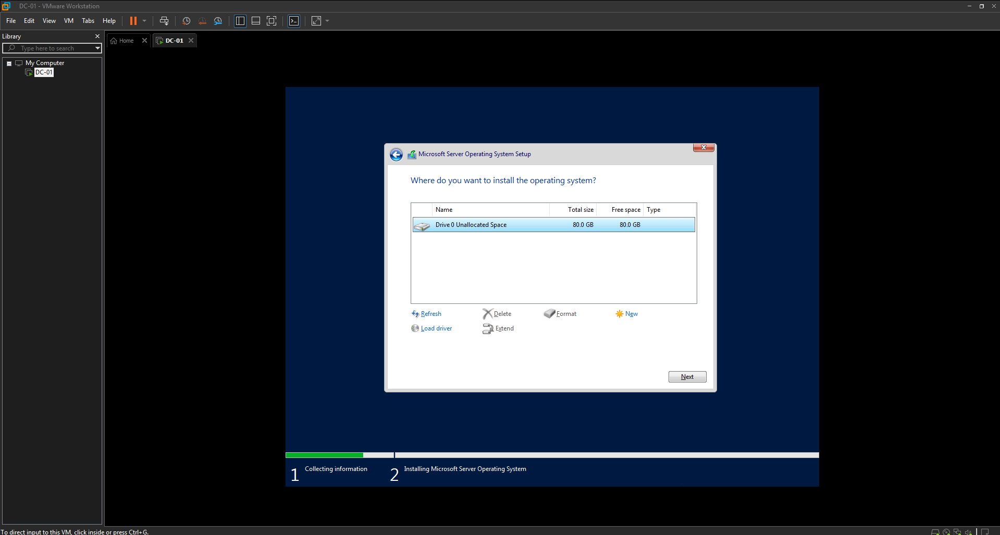

---

### 2.6 Complete File Copy & Initial Administrator Setup
Allow Windows Setup to copy system files, install features, and reboot automatically. Once it finishes rebooting to the *Customize settings* screen, configure a strong password for the built-in local **`Administrator`** account and click **Finish**.

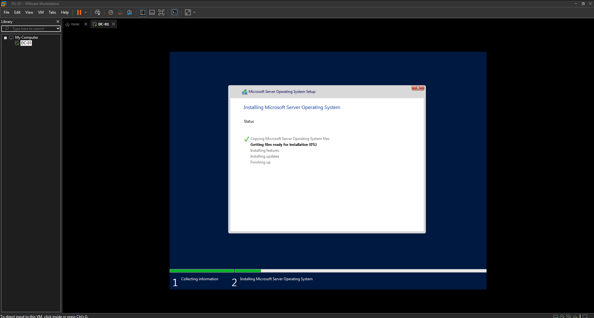

---

### 2.7 Unlock & Sign In to the Server
Once the Windows Server lock screen loads, press **Ctrl + Alt + Insert** (or select **VM > Send Ctrl+Alt+Del** from the top VMware menu bar) and sign in with your `Administrator` credentials. When prompted by Windows to allow your PC to be discoverable on the network, click **Yes** to apply the **Private** firewall profile.

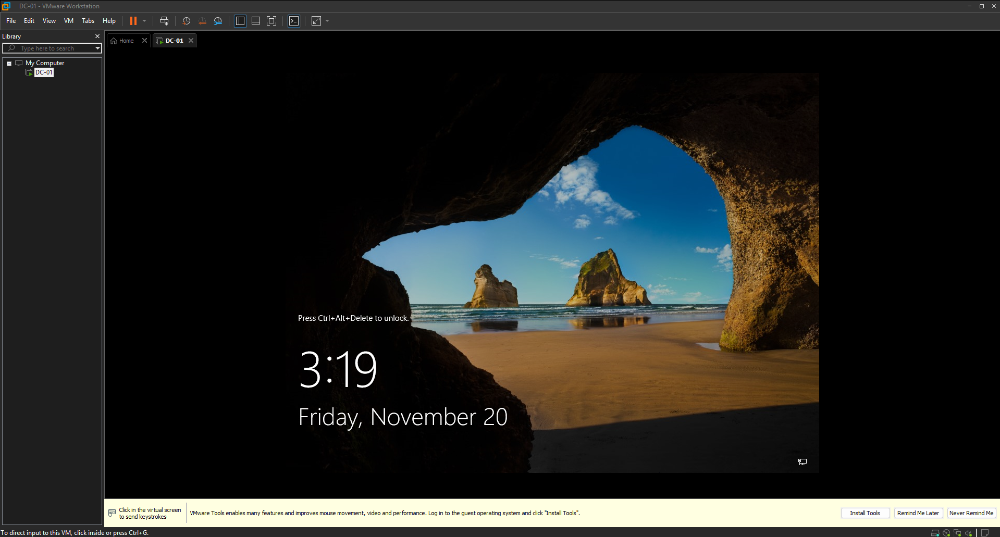

---

## Step 3: Inspect the Default VMware NAT Network
Before assigning a static IP address, check the subnet boundaries assigned by VMware's virtual NAT switch (`VMnet8`).

1. Open Command Prompt (`Win + R` > `cmd`) and run:
   ```cmd
   ipconfig /all
   ```
2. Record the key network parameters from the output:
   * **Initial Host Name:** `WIN-596OAR12VR0` (random default name)
   * **Subnet & Mask:** `192.168.198.0/24` (`255.255.255.0`)
   * **Default Gateway:** `192.168.198.2`
   * **Initial Dynamic IP:** `192.168.198.130` (VMware's built-in DHCP server at `.254` assigns dynamic leases starting from `.128`)

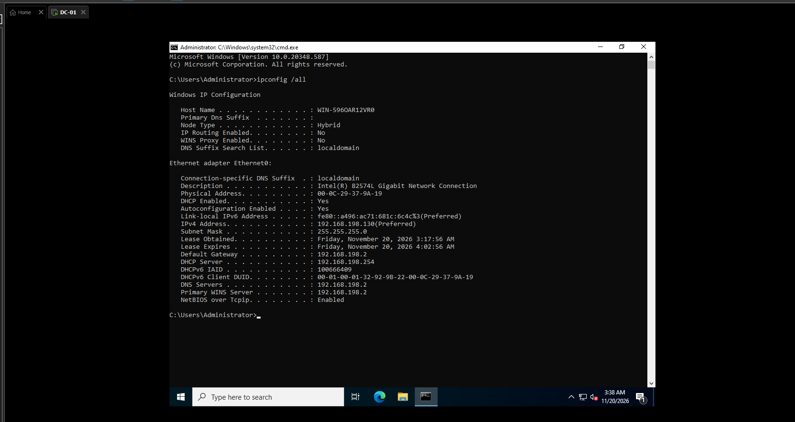

---

## Step 4: Configure a Static IPv4 Address (`ncpa.cpl`)
Domain Controllers must use a static IP address so client computers and member servers can reliably locate DNS and Kerberos authentication services without losing connectivity when DHCP leases expire.

1. Press `Win + R`, type `ncpa.cpl`, and press **Enter** to open **Network Connections**.
2. Right-click **Ethernet0** > **Properties**, select **Internet Protocol Version 4 (TCP/IPv4)**, and click **Properties**.
3. Select **Use the following IP address** and enter:
   * **IP address:** `192.168.198.10` *(reserves `.10–.50` for static infrastructure servers outside VMware's `.128+` DHCP pool)*
   * **Subnet mask:** `255.255.255.0`
   * **Default gateway:** `192.168.198.2`
   * **Preferred DNS server:** `127.0.0.1` *(points the server to itself in preparation for the local AD-integrated DNS role)*
   * **Alternate DNS server:** `8.8.8.8`
4. Click **OK** on both dialog boxes to apply the static network settings.

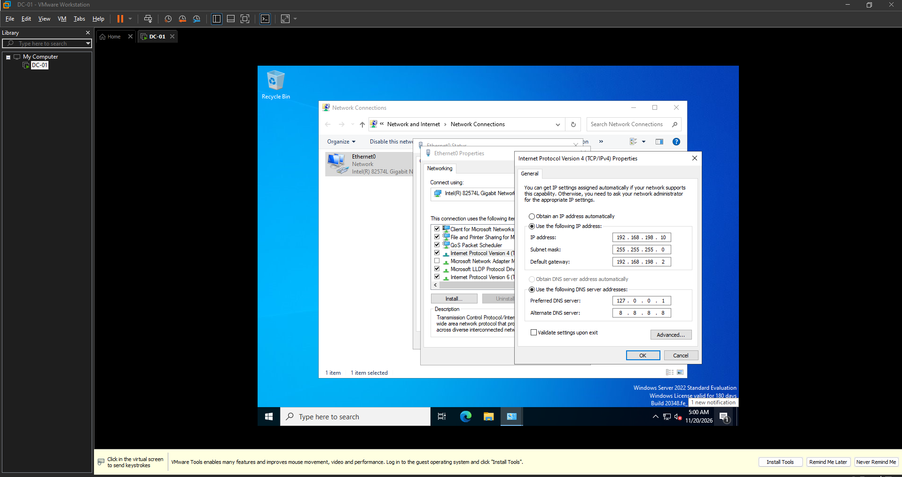

---

## Step 5: Standardize the Server Hostname (`sysdm.cpl`)
Rename the server from its random default name to match its infrastructure role before promoting it to a Domain Controller.

1. Press `Win + R`, type `sysdm.cpl`, and press **Enter** to open **System Properties**.
2. On the **Computer Name** tab, click **Change...**.
3. Enter **`DC-01`** in the **Computer name** field, leave **Member of** set to `WORKGROUP`, and click **OK**.
4. Restart the server when prompted so the new hostname takes effect.

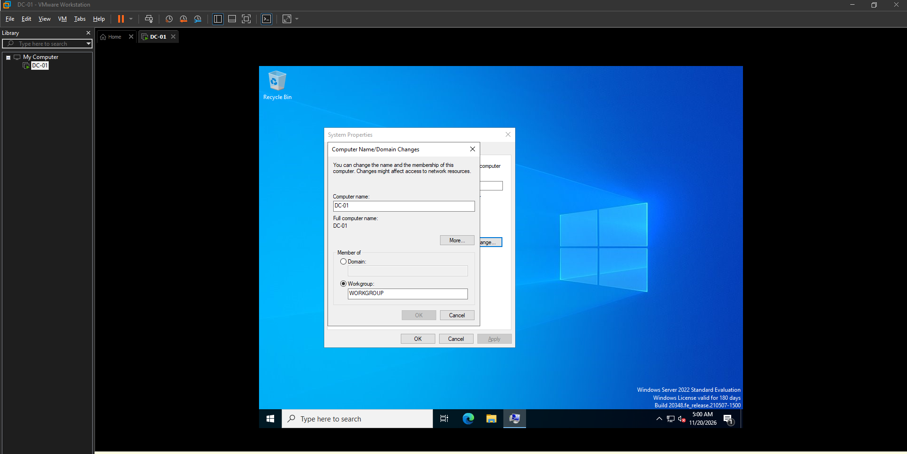

---

## Step 6: Verification & Clean Baseline Snapshot
1. After rebooting and logging back in, open Command Prompt (`cmd`) and run `ipconfig /all` to verify that **`DHCP Enabled`** is now **`No`**, the **Host Name** is **`DC-01`**, the **IPv4 Address** is **`192.168.198.10`**, and the **DNS Servers** list **`127.0.0.1`** and **`8.8.8.8`**.

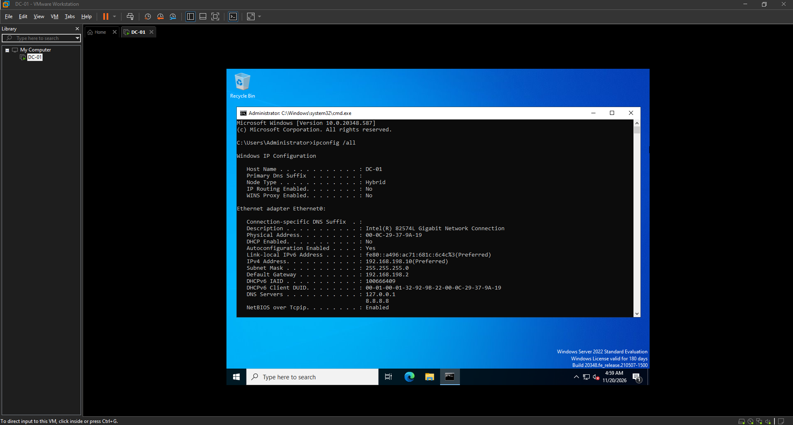

2. In VMware Workstation Pro, select **VM > Snapshot > Take Snapshot...** and save a recovery checkpoint named **`01-Clean-Server-Baseline`**. Confirm in **Snapshot Manager** that the **You Are Here** pointer branches directly off this snapshot—allowing instant rollback if any errors occur during Active Directory deployment.

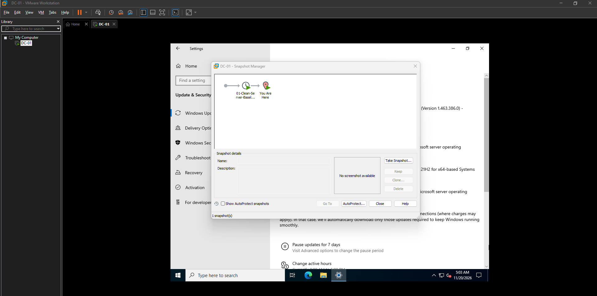

---
