# Module 02: Installing Active Directory Domain Services (AD DS) & DNS Setup

## Objective
Transform **`DC-01`** (`192.168.198.10`) from a standalone workgroup server into the primary **Domain Controller** and **AD-Integrated DNS Server** for a brand-new Active Directory forest named **`core.local`**.

---

## Core Architecture & Terminology

| Concept | Role in This Lab |
| :--- | :--- |
| **Active Directory (AD DS)** | Centralized identity database (`NTDS.dit`) storing domain users, computers, security groups, and authentication policies. |
| **Forest & Root Domain (`core.local`)** | Top-level security and directory boundary. Because `DC-01` is the first Domain Controller on the network, it establishes a new forest (`core.local`, NetBIOS name `CORE`). |
| **Global Catalog (GC)** | Searchable directory index required on the primary Domain Controller to process user logons and cross-domain lookups. |
| **DSRM Password** | **Directory Services Restore Mode** recovery password used exclusively when booting into safe repair mode to restore a corrupted Active Directory database. |
| **AD-Integrated DNS & Forwarders** | Stores internal host records (`A` and `PTR`) securely inside Active Directory while forwarding external internet queries to upstream resolvers (`8.8.8.8`). |

---

## Step 1: Install AD DS and DNS Server Roles

### 1.1 Open Server Manager Dashboard
Log in to **`DC-01`** as the local `Administrator` and wait for **Server Manager** to finish loading its initial service tiles.

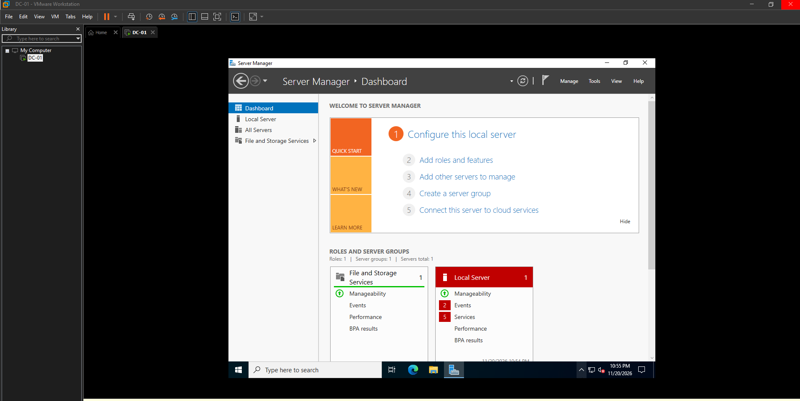

---

### 1.2 Launch the Add Roles and Features Wizard
Click **Manage** in the top-right navigation bar and select **Add Roles and Features** (or click link **2. Add roles and features** directly on the dashboard).

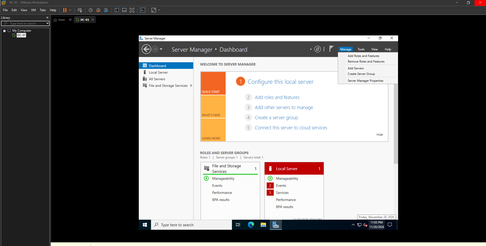

---

### 1.3 Review Prerequisites on Before You Begin
Verify that the three baseline checks listed on the **Before you begin** page—a strong Administrator password, a configured static IP address (`192.168.198.10`), and current security updates—are satisfied, then click **Next >**.

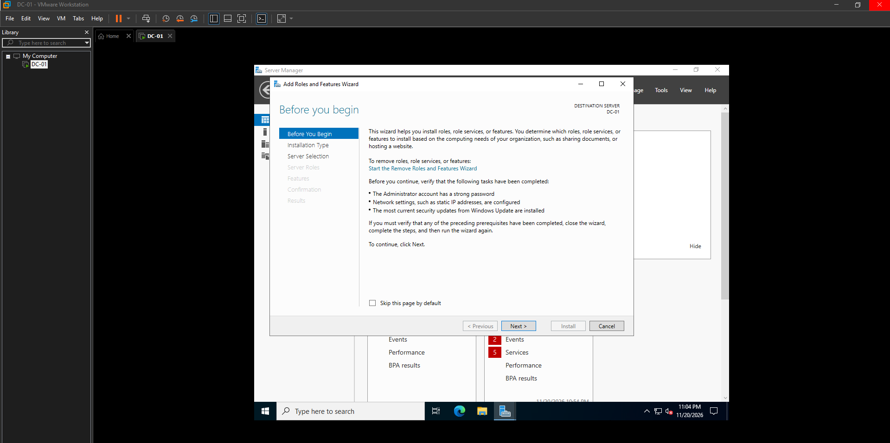

---

### 1.4 Select Installation Type
Keep **Role-based or feature-based installation** selected and click **Next >**. This mode installs standard infrastructure roles directly onto a single local or remote Windows Server instance.

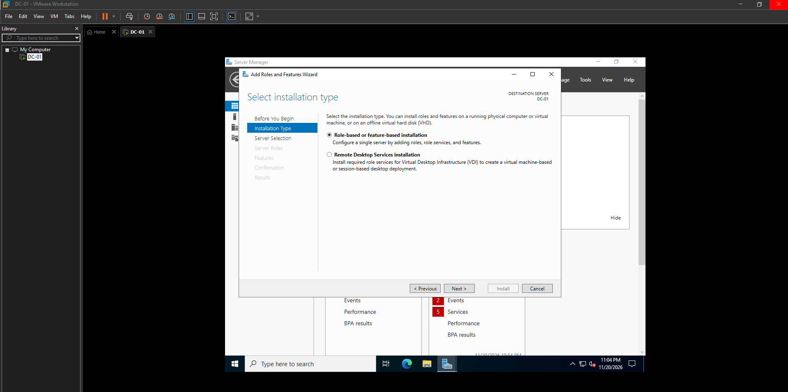

---

### 1.5 Select Destination Server (`DC-01`)
Confirm **Select a server from the server pool** is chosen, verify **`DC-01`** (`192.168.198.10`) is highlighted, and click **Next >**.

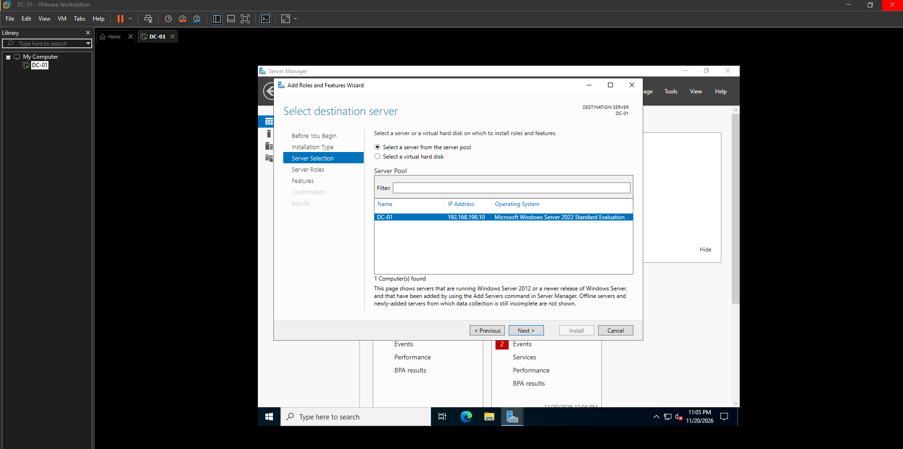

---

### 1.6 Select Active Directory Domain Services & DNS Server Roles
1. Check **Active Directory Domain Services**. When prompted to add required management tools, click **Add Features**.
2. Check **DNS Server** and click **Add Features** on its popup prompt as well.
3. Verify both roles are checked and click **Next >**.

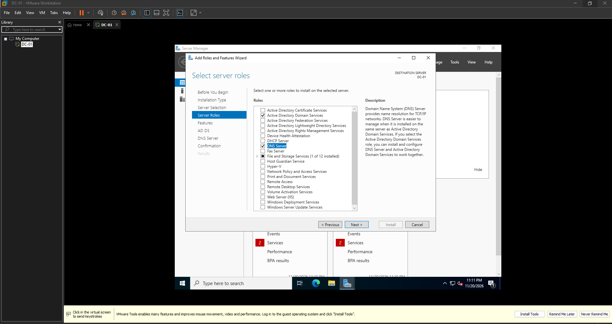

---

### 1.7 Review Automatically Selected Features
On the **Select features** screen, notice that **Group Policy Management** (along with Remote Server Administration Tools) is automatically selected. Leave these defaults untouched and click **Next >**.

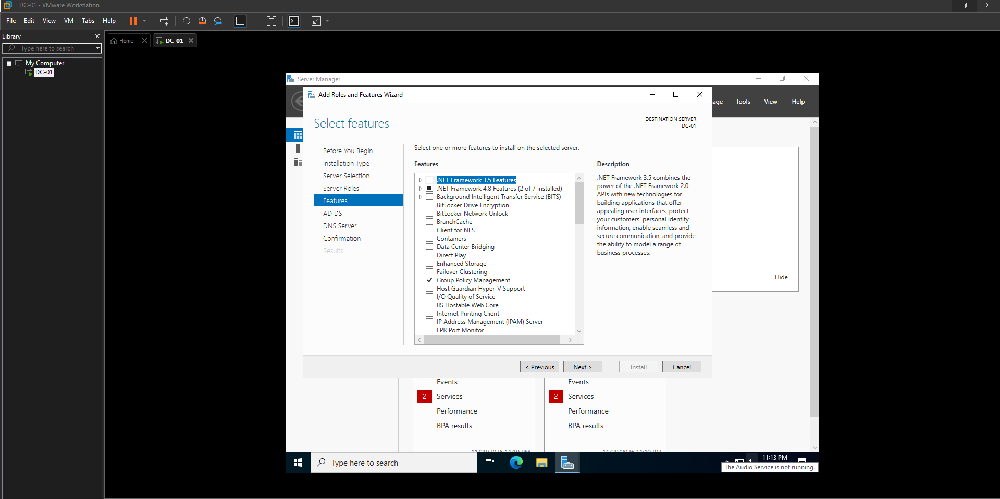

---

### 1.8 Review AD DS and DNS Informational Summaries
Read the architectural notes on the **Active Directory Domain Services** overview page—specifically noting that AD DS requires a DNS server on the network—and click **Next >** through both the AD DS and DNS Server summary pages.

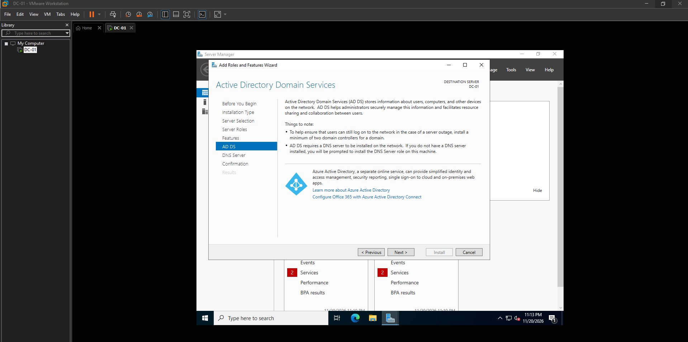

---

### 1.9 Confirm Installation Selections
Check **Restart the destination server automatically if required**, click **Yes** on the confirmation dialog, review the selected roles and RSAT tools, and click **Install**.

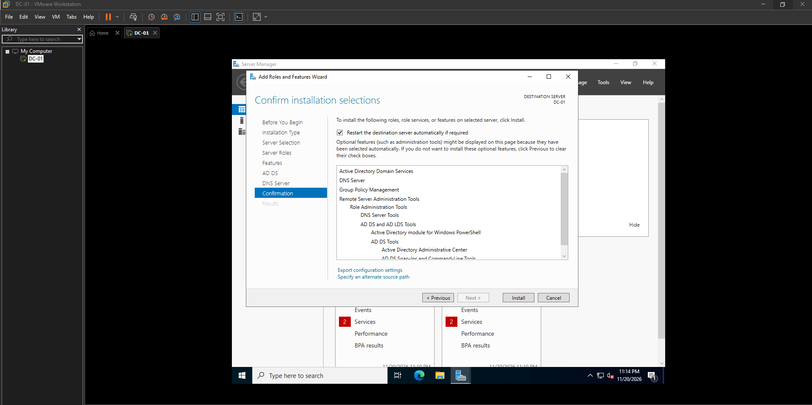

---

### 1.10 Monitor Role Installation Progress
Wait for the feature installation progress bar to complete. You can leave this wizard open until the post-deployment promotion link appears.

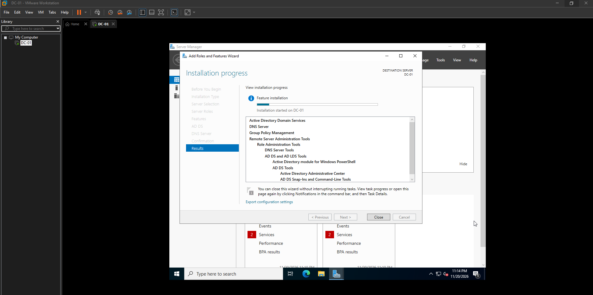

---

### 1.11 Confirm Role Installation Completion
Verify the progress bar finishes with **`Configuration required. Installation succeeded on DC-01.`** and click **Close** to exit the Add Roles and Features Wizard.


---

## Step 2: Promote `DC-01` to a Domain Controller (`core.local`)

### 2.1 Launch the AD DS Configuration Wizard
In the top navigation bar of Server Manager, click the **Notifications** flag icon (marked with a yellow warning triangle) and click the blue **Promote this server to a domain controller** link.

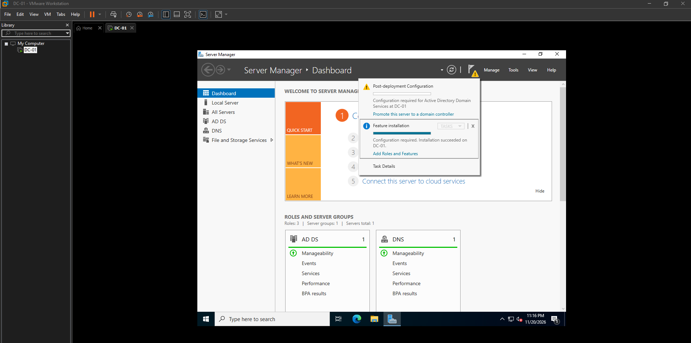

---

### 2.2 Configure Forest & Root Domain (`core.local`)
On the **Deployment Configuration** screen, select **Add a new forest**, enter **`core.local`** in the **Root domain name** field, and click **Next >**.

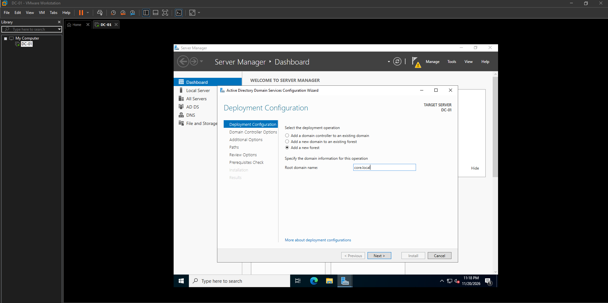

---

### 2.3 Configure Domain Controller Options & DSRM Password
1. Leave **Forest functional level** and **Domain functional level** set to **Windows Server 2016** (the highest selectable functional level in Windows Server 2022).
2. Ensure **Domain Name System (DNS) server** and **Global Catalog (GC)** remain checked.
3. Enter and confirm a strong **Directory Services Restore Mode (DSRM)** password, then click **Next >**.


---

### 2.4 Bypass Expected DNS Delegation Warning
On the **DNS Options** page, leave **Create DNS delegation** unchecked and click **Next >**.
> **Note:** The yellow banner stating *"A delegation for this DNS server cannot be created because the authoritative parent zone cannot be found"* is completely normal when deploying a brand-new root forest (`core.local`) with no parent DNS hierarchy above it.

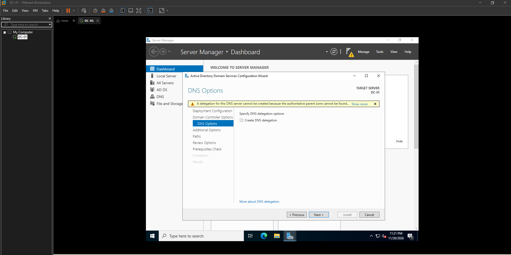

---

### 2.5 Verify NetBIOS Domain Name (`CORE`)
Confirm the **NetBIOS domain name** auto-populates as **`CORE`** (used for legacy backward-compatible authentication and `CORE\Administrator` sign-in formatting) and click **Next >**.


---

### 2.6 Review AD DS Database, Log, and SYSVOL Paths
Accept the default storage directories (`C:\Windows\NTDS` for the Active Directory database and transaction logs, and `C:\Windows\SYSVOL` for replicated Group Policy files) and click **Next >**.

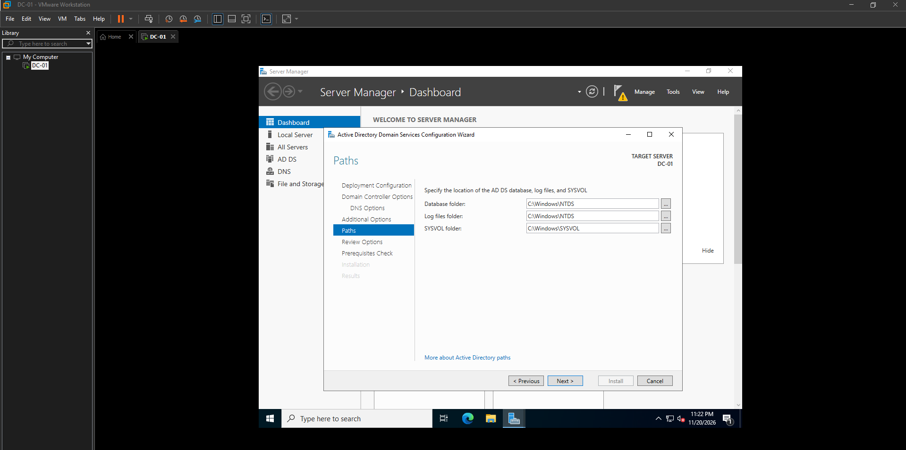

---

### 2.7 Review Promotion Options
Review the configuration summary confirming `DC-01` will be promoted as the first Domain Controller, Global Catalog, and DNS server in the new **`core.local`** forest, then click **Next >**.


---

### 2.8 Run Prerequisites Check & Begin Promotion
Verify the green banner displays **`All prerequisite checks passed successfully. Click 'Install' to begin installation.`** and click **Install**.
> **Note:** The informational warnings regarding Windows NT 4.0 cryptographic algorithms and DNS delegation are standard defaults on Windows Server 2022 and do not impact domain health.

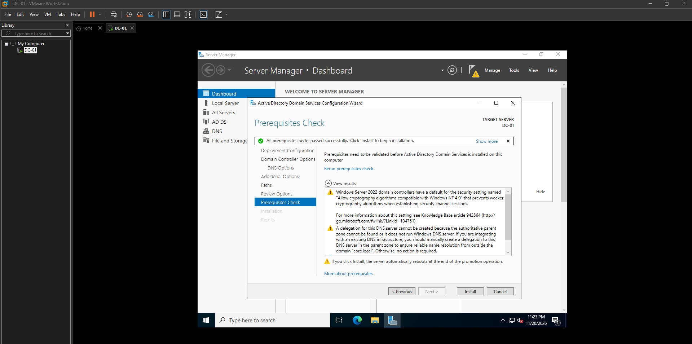

---

### 2.9 Complete Promotion & Automatic Reboot
Once Active Directory configuration finishes, Windows Server automatically signs you out and reboots `DC-01` to initialize the domain services and `SYSVOL` shares.

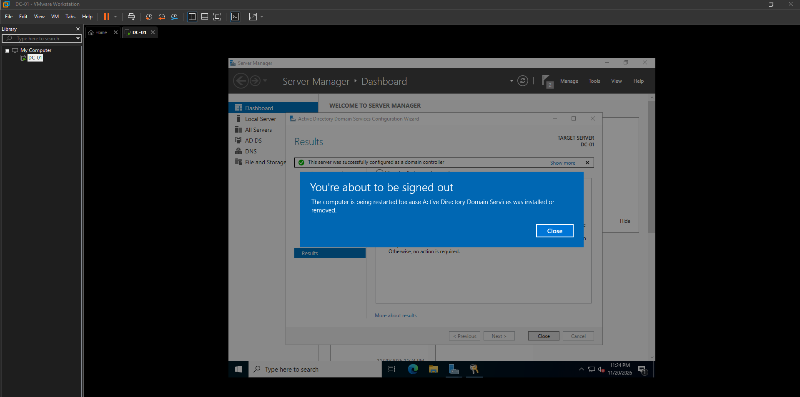

---

## Step 3: Post-Promotion Verification & DNS Reverse Lookup Configuration

### 3.1 Sign In as Domain Administrator (`CORE\Administrator`)
After `DC-01` finishes rebooting and applying domain security policies, press **Ctrl + Alt + Insert** (or **VM > Send Ctrl+Alt+Del**). Notice the sign-in prompt now defaults to **`CORE\Administrator`** instead of a local machine account—enter your Administrator password to log in.

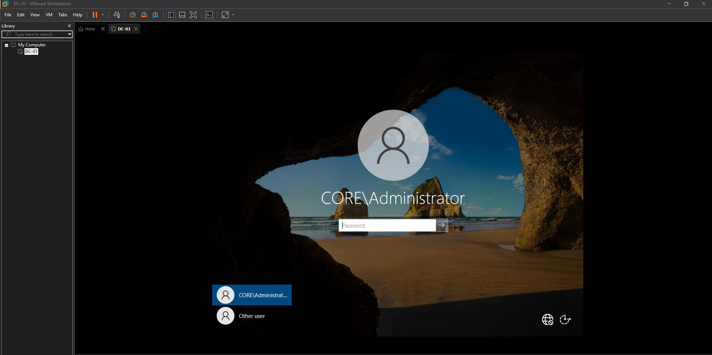

---

### 3.2 Verify Domain Membership in Server Manager
Open **Server Manager > Local Server** and confirm that the **Domain** property now displays **`core.local`**, verifying that `DC-01` is actively operating as the Domain Controller.

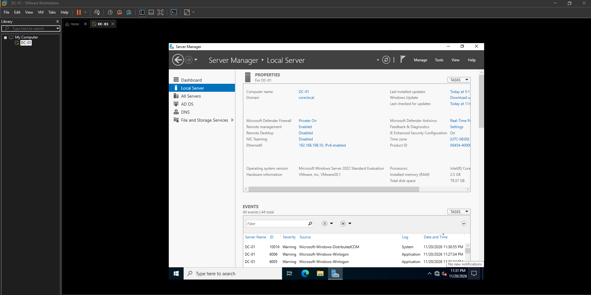

---

### 3.3 Launch DNS Manager from Server Manager Tools
Click **Tools** in the top-right menu bar of Server Manager and select **DNS** (notice Active Directory administrative consoles such as *Active Directory Users and Computers* and *Active Directory Sites and Services* are now installed here as well).

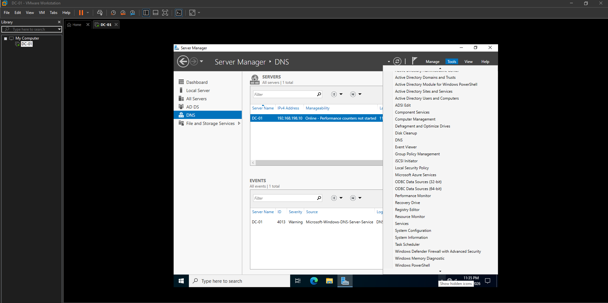

---

### 3.4 Expand `DC-01` in DNS Manager
In the left navigation tree of **DNS Manager**, expand **`DC-01`** to view the four core DNS container folders: **Forward Lookup Zones**, **Reverse Lookup Zones**, **Trust Points**, and **Conditional Forwarders**.


---

### 3.5 Create a New Reverse Lookup Zone
Right-click **Reverse Lookup Zones** and select **New Zone...**, then click **Next >** on the welcome page to launch the zone configuration wizard.
> **Why Configure a Reverse Lookup Zone?** Active Directory automatically builds the *Forward Lookup Zone* (`core.local` → IP) during promotion, but it does **not** build a *Reverse Lookup Zone* (IP → `core.local`). Creating one ensures `nslookup` and network diagnostic tools resolve `192.168.198.10` cleanly back to `dc-01.core.local`.

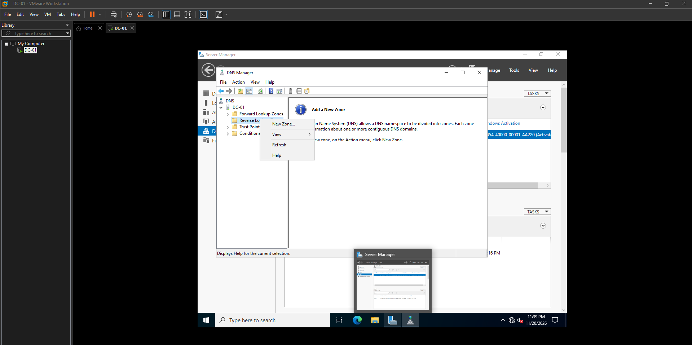

---

### 3.6 Select Primary Zone & Active Directory Integration
Keep **Primary zone** selected along with **Store the zone in Active Directory (available only if DNS server is a writeable domain controller)**, then click **Next >**. Storing the zone inside AD DS ensures automatic, encrypted multi-master replication if additional Domain Controllers are added later.


---

### 3.7 Choose Active Directory Zone Replication Scope
Select **To all DNS servers running on domain controllers in this domain: `core.local`** and click **Next >**.


---

### 3.8 Select IPv4 Reverse Lookup Zone
Choose **IPv4 Reverse Lookup Zone** and click **Next >**.

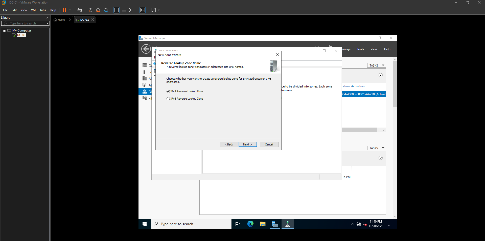

---

### 3.9 Enter the Network ID (`192.168.198`)
In the **Network ID** field, enter the first three octets of your lab subnet in normal order: **`192.168.198`**. Notice that Windows automatically constructs the reverse zone name (`198.168.192.in-addr.arpa`) below. Click **Next >**.

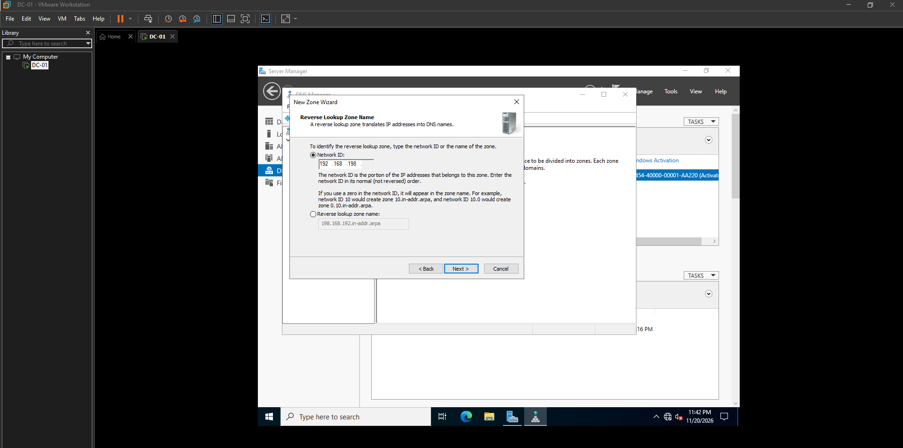

---

### 3.10 Configure Secure Dynamic Updates
Keep **Allow only secure dynamic updates (recommended for Active Directory)** selected and click **Next >**. This restricts DNS record updates strictly to authenticated domain-joined machines, preventing unauthorized DNS spoofing.


---

### 3.11 Complete the New Zone Wizard
Review the zone creation summary confirming **`198.168.192.in-addr.arpa`** is configured as an **Active Directory-Integrated Primary** reverse lookup zone, then click **Finish**.

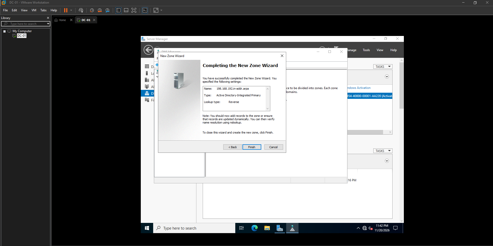

---

### 3.12 Confirm the Reverse Lookup Zone Status
Verify that **`198.168.192.in-addr.arpa`** appears under **Reverse Lookup Zones** with its status set to **Running**.

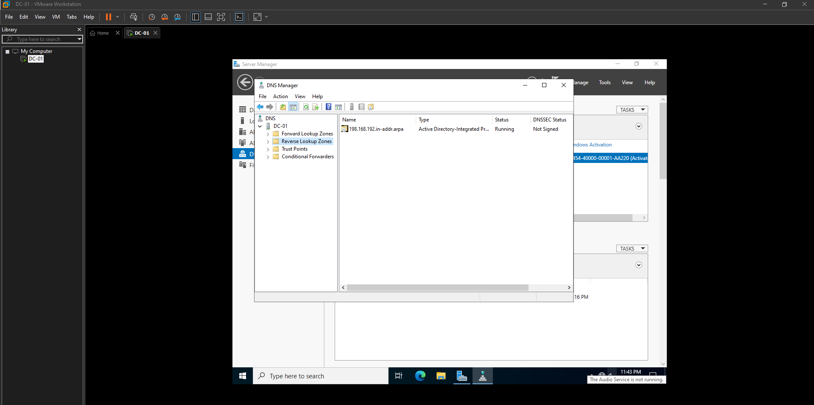

---

### 3.13 Inspect Forward Lookup Zones (`core.local`)
In the left tree pane of DNS Manager, expand **Forward Lookup Zones** to verify both **`_msdcs.core.local`** (Active Directory service discovery records) and **`core.local`** are running.

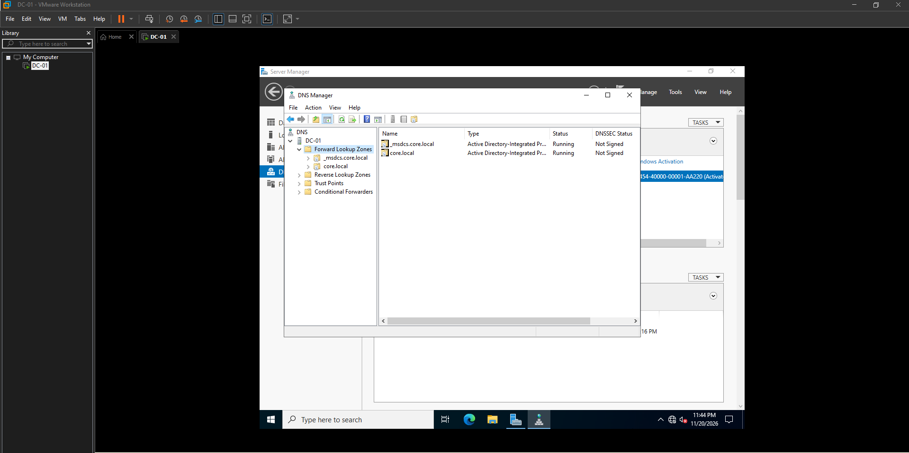

---

### 3.14 Locate `DC-01` Host (`A`) Record in `core.local`
Click **`core.local`** under Forward Lookup Zones and locate the **`dc-01`** **Host (`A`)** record pointing to `192.168.198.10`.

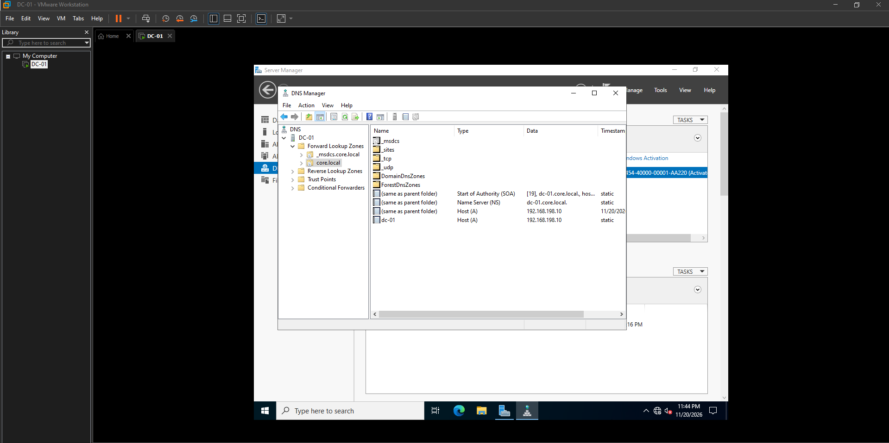

---

### 3.15 Register `DC-01`'s Pointer (`PTR`) Record
Double-click the **`dc-01`** Host (`A`) record, check **Update associated pointer (PTR) record**, and click **OK**. This automatically generates the matching reverse lookup entry inside `198.168.192.in-addr.arpa`.

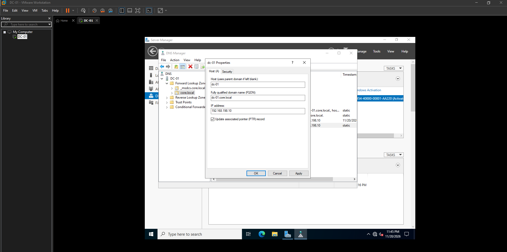

---

### 3.16 Verify the Pointer (`PTR`) Record in Reverse Lookup Zone
Expand **Reverse Lookup Zones**, click **`198.168.192.in-addr.arpa`**, and press **`F5`** to refresh. Confirm that a **Pointer (`PTR`)** record for **`192.168.198.10`** now resolves cleanly to **`dc-01.core.local.`**.


---

### 3.17 Configure External DNS Forwarders (`8.8.8.8`)
1. In the left pane of **DNS Manager**, right-click **`DC-01`** and select **Properties**.
2. Switch to the **Forwarders** tab, click **Edit...**, add **`8.8.8.8`** (Google Public DNS), and wait for it to validate (`dns.google`).
3. Keep **Use root hints if no forwarders are available** checked and click **OK**.
> **Why Configure Forwarders?** Domain-joined client PCs point exclusively to `DC-01` (`192.168.198.10`) for DNS. Forwarders allow `DC-01` to resolve internal `core.local` records locally while forwarding external internet queries (such as `google.com` or Windows Updates) upstream.


---

## Step 4: Final DNS Verification & Module 02 Snapshot

### 4.1 Verify Forward, Reverse, and External Resolution (`nslookup` & `ping`)
Open Command Prompt (`Win + R` > `cmd`) and run the following three diagnostic commands:

```cmd
nslookup core.local
nslookup 192.168.198.10
ping google.com
```

Verify the following expected results:
* **`nslookup core.local`:** Resolves `core.local` directly to **`192.168.198.10`** (confirming the Forward Lookup Zone is working).
* **`nslookup 192.168.198.10`:** Resolves `192.168.198.10` back to **`dc-01.core.local`** (confirming the Reverse Lookup Zone and `PTR` record are working).
* **`ping google.com`:** Resolves an external public IP address and receives replies (confirming DNS Forwarders and NAT internet routing are functioning).
> **Note on `Server: Unknown / Address: ::1`:** Windows Server automatically enables IPv6 loopback (`::1`) as the primary local DNS listener during AD DS promotion. Because no IPv6 reverse zone exists in this IPv4-only lab, `nslookup` displays `Unknown` for `::1` while still accurately resolving all IPv4 forward and reverse queries.

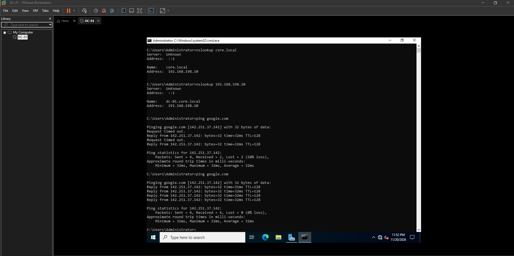

---

### 4.2 Capture Clean Module 02 Snapshot (`02-AD-DNS-Configured`)
1. Shut down `DC-01` cleanly (`Start > Power > Shut down`) so no live memory state files bloat the snapshot.
2. In VMware Workstation Pro, select **VM > Snapshot > Take Snapshot...**, name it **`02-AD-DNS-Configured`**, and click **Take Snapshot**.
3. Open **VM > Snapshot > Snapshot Manager** and confirm **`02-AD-DNS-Configured`** branches cleanly off `01-Clean-Server-Baseline` with the **You Are Here** marker attached.

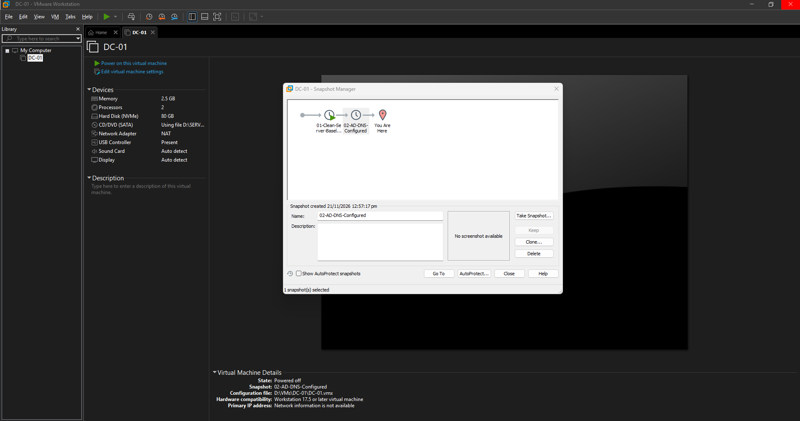